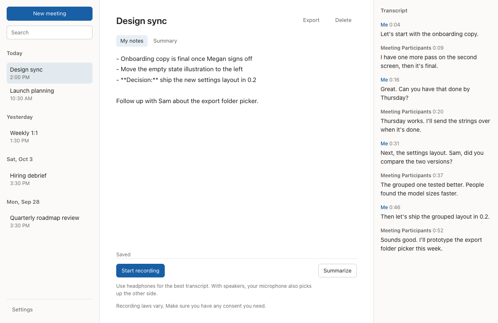

# Earshot Notes

**Meeting notes that never leave your Mac.**

Earshot Notes transcribes your calls, gives you a notepad while you talk, and turns your notes and the transcript into meeting notes. All of it runs on your Mac.

**[Download the latest release](https://github.com/tapresle/Earshot-Notes/releases/latest)** for Macs with Apple Silicon and macOS 26 or later.

<picture>
  <source media="(prefers-color-scheme: dark)" srcset="docs/screenshots/meeting-dark.png">
  
</picture>

## Private by design

Your meetings stay on your Mac.

- **On-device:** transcription, summaries, and chat run on your Mac. Audio, transcripts, notes, summaries, and chats are stored on it and nowhere else.
- **Nothing to sign up for:** no account, no cloud service, no subscription, and no analytics. The app's logs stay on your Mac too.
- **Works offline:** once a local AI model is downloaded, Earshot Notes makes no network requests. The only ones it ever makes are the model downloads you start.
- **No recordings by default:** audio is transcribed and discarded. It's kept only if you turn on **Keep audio recordings** in **Settings**.
- **Free and open source:** licensed under the GNU General Public License, version 3, so anyone can check these claims in the code.

## How it's different

| Most AI note takers | Earshot Notes |
|---|---|
| Upload your audio to their servers | Transcribes and summarizes on your Mac |
| Need an account and a subscription | Needs neither, and it's free and open source |
| Use whichever model the vendor picked | Lets you choose the model, or bring your own |
| Stop working without a connection | Works offline once a model is downloaded |
| Ask you to trust their privacy policy | Lets anyone check the code |

## What it does

- **Both sides of the call:** a live transcript of your microphone and the other participants, labeled **Me** and **Meeting Participants**.
- **A notepad during the meeting:** type rough notes as you go. They become the outline of the summary.
- **Summaries on request:** during or after the meeting, notes grouped by topic, with the specifics kept and next steps with their owners.
- **Ask about a meeting:** in the **Chat** tab, ask a question such as "What did we decide about the launch date?" The local model answers from the meeting's transcript and your notes, and each answer links to the lines it came from.
- **Your vocabulary:** list the names your meetings use, and what transcription mishears them as, so transcripts and summaries spell them right.
- **Find and export:** search titles, notes, and transcripts, and export any meeting to Markdown. Untitled meetings are named from their summaries.
- **Out of the way:** Earshot Notes lives in the menu bar, keeps recording with its window closed, and can open at login.

## Choose your transcription model

Two models transcribe on your Mac. Choose one in **Settings** > **Transcription**; the choice applies from the next recording.

| | Whistle | Whisper large-v3-turbo |
|---|---|---|
| **Get it** | Included, and works from the first launch | A 574 MB download from **Settings** |
| **Accuracy** | Good with clear audio, such as your own microphone | About half the errors, and far more technical terms right |
| **The other side of a call** | Struggles when the call app reduces audio to phone quality | Much better |
| **Speed and memory** | Very fast, a fraction of a second per phrase, and very little memory | About 40 times faster than real time on Apple Silicon. Heavier: stays loaded while the app is open, using about 1 GB of memory |
| **Your vocabulary** | Listens for your terms as it transcribes | Doesn't listen for terms; **Heard as** corrections and summary spellings still apply |

Whistle is the default. The measurements are in [the transcription model comparison](docs/benchmarks/20261009-transcription-models.md).

## Bring your own local AI model

You decide which model writes your notes.

- **Choose from the list:** in **Settings**, download Qwen3.5 4B (recommended), Gemma 4 E4B, Ministral 3 8B, or Qwen3.5 9B. Each download is pinned to a checksum and verified before use.
- **Or import your own:** import any GGUF model file you already have.
- **Built for Apple Silicon:** summaries run through [llama.cpp](https://github.com/ggml-org/llama.cpp) with Metal. Every listed model is sized to leave room for your call on a Mac with 16 GB of memory.
- **One model for summaries and chat:** the selected model writes summaries and answers questions.
- **Loaded when you need it:** the model loads on your first summary or question and stays loaded for five minutes after the last one, so the next one starts sooner. In **Settings**, choose **Never**, **15 minutes**, or **Always** instead.

## How it works

1. Earshot Notes listens to your microphone and to your Mac's audio output.
2. Whistle or Whisper transcribes each source on your Mac as you talk.
3. When you ask for a summary, your notes and the transcript go to the local model you chose.
4. The model writes your meeting notes, which stay on your Mac with the transcript.

## Get started

1. Check that your Mac has Apple Silicon and macOS 26 or later.
2. Download the disk image from the [latest release](https://github.com/tapresle/Earshot-Notes/releases/latest), open it, and drag **Earshot Notes** to **Applications**.
3. Open Earshot Notes. A checklist asks for two permissions:
   - **Microphone:** for your side of the conversation.
   - **Screen & System Audio Recording:** for the other side of your calls. Earshot Notes records only audio, never your screen. If you decline, recording continues with only your microphone.
4. Download a local AI model from the checklist or from **Settings**. Qwen3.5 4B, the recommended model, is 2.7 GB.

What's new in each version is on the [releases page](https://github.com/tapresle/Earshot-Notes/releases).

## Build from source

With Xcode, Rust, Node.js, and CMake installed, run `./scripts/fetch-native.sh`, `npm install`, and `./scripts/build-macos.sh`. [Building Earshot Notes](docs/building.md) covers each step, signing, and notarizing.

## Contributing

Bug reports, ideas, and pull requests are welcome. [Contributing to Earshot Notes](CONTRIBUTING.md) covers setup, the checks, and the one firm rule: never share real meeting content. To report a security problem privately, see the [security policy](SECURITY.md).

## License

Earshot Notes is free software, licensed under the [GNU General Public License, version 3](LICENSE) only (`GPL-3.0-only`).

It bundles the needle engine and the Whistle model (Apache 2.0), links llama.cpp (MIT), and bundles whisper.cpp (MIT). [Cactus Whistle](https://huggingface.co/Cactus-Compute/whistle) is included; [Whisper large-v3-turbo](https://huggingface.co/ggerganov/whisper.cpp) (MIT) downloads when you ask. Their licenses, and the notices for every Rust crate and JavaScript package compiled into the app, are in the app bundle under `Contents/Resources/licenses`.
