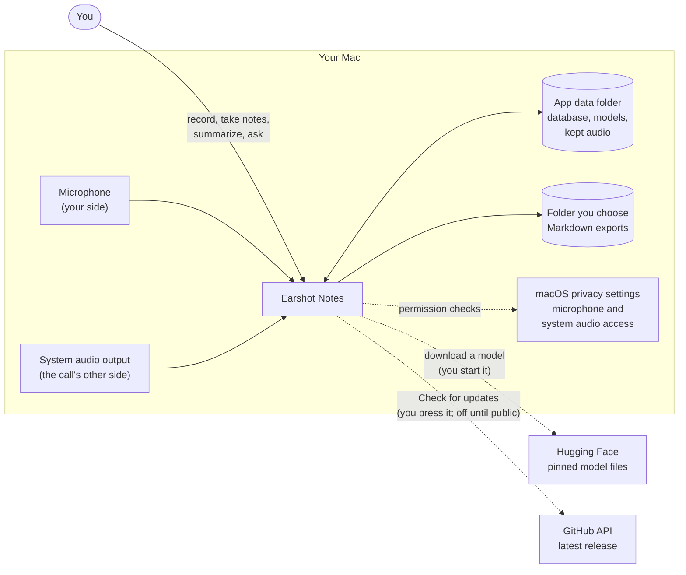
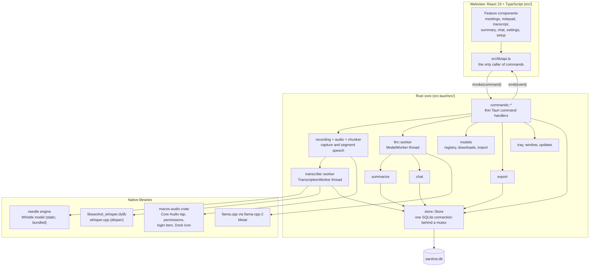

# Architecture

Earshot Notes is a macOS menu bar app that records a meeting's two sides, transcribes them on the device, and lets you summarize and ask questions about the meeting with a local AI model. Nothing leaves the Mac except two downloads and an update check that you start yourself.

This page is the high-level view. Each subsystem has its own page:

| Page | Covers |
|---|---|
| [Recording and transcription](recording-and-transcription.md) | Audio capture, the per-source pipeline, speech segmentation, Whistle and Whisper, echo and vocabulary correction |
| [Local AI model](local-ai-model.md) | `ModelWorker`, keeping the model loaded, summaries with condensing, chat with citations |
| [Models and downloads](models-and-downloads.md) | The pinned registry, verified downloads, GGUF import, choosing the summary and transcription models |
| [Storage](storage.md) | The SQLite schema, full-text search, settings, and files on disk |
| [User interface](user-interface.md) | The React app, `api.ts`, commands and events, and the fake backend used by tests and screenshots |
| [App shell and lifecycle](app-shell-and-lifecycle.md) | Startup, the menu bar and window, quitting safely, and the network boundary |

## System context

What Earshot talks to. Solid lines run on every recording; dashed lines run only when you ask.

## Containers

The app is one Tauri 2 process. A React UI runs in the system webview and talks to a Rust core through commands (requests) and events (pushes). The core does its slow work on dedicated threads.

## Threads

Each long-running job has one owner thread, so the UI thread never waits on audio, transcription, or the model.

| Thread (name in code) | Started by | Owns | Talks to |
|---|---|---|---|
| Main (Tauri event loop) | the app | the window, the tray, synchronous commands | everything, through managed `Arc` state |
| Blocking pool | `commands::blocking` (`spawn_blocking`) | `async` commands that touch the database, disk, or another thread | `Store`, workers |
| `mic-capture` | `audio::mic::start` | the cpal input stream | its pipeline, through a bounded channel |
| Core Audio's tap callback, and `system-audio-follower` | `audio::system::start` | the system audio tap; the follower rebuilds it when the output device changes | its pipeline, through a bounded channel |
| `audio-pipeline-Me`, `audio-pipeline-Them` | `recording::start_recording` | downmix, resampling to 16 kHz, `Chunker` | `TranscriptionWorker::submit`, the kept-audio writer |
| `kept-audio-writer`, one per source | `recordings::KeptAudio::spawn` | a WAV file, when **Keep audio recordings** is on | the disk |
| `transcription` | `TranscriptionWorker::spawn` | Whistle, and Whisper when chosen | `Store::insert_transcribed_segment`, `transcript:*` events |
| `model-worker` | `ModelWorker::spawn` | the loaded llama.cpp model (`llm::resident::Resident`) | `summary:*` and `chat:*` events, `Store` |
| `model-download`, plus a body reader | `models::manager::Downloads::start` | one download at a time, of either kind | `model:download-*` or `transcription:download-*` events |

Capture threads never block: when the bounded channel to the pipeline is full, they drop the buffer (`try_send`).

## Principles that shape the design

- **Offline by default.** The webview's Content Security Policy blocks network requests. Only Rust code makes requests, and only to fetch a pinned model file or to check for a release, each started by you.
- **One owner per native model.** needle's engine is process-global and not thread-safe, and ggml's Metal backend aborts at exit while a model is loaded. Each engine lives on one thread, and quitting frees each model before the process exits.
- **Thin commands.** Command handlers parse input and call into a module. The modules hold the logic and are tested without Tauri.
- **Untrusted text stays data.** Transcript and notes text goes into prompts as data, and model output is rendered as Markdown, never HTML.
