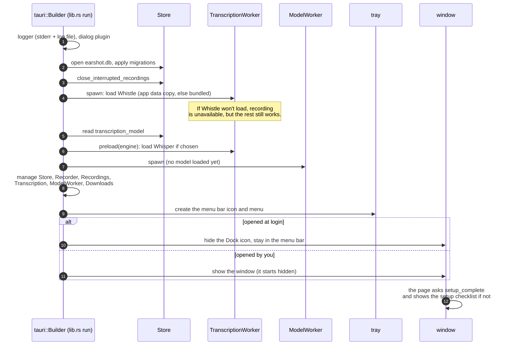
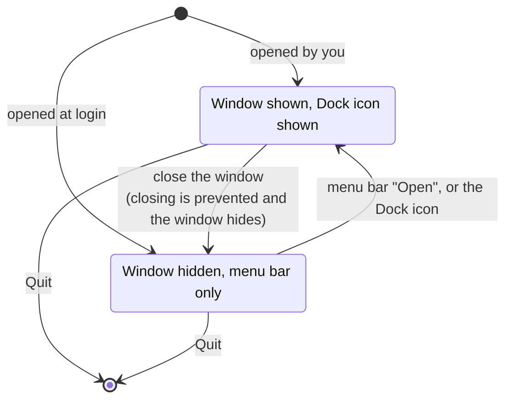
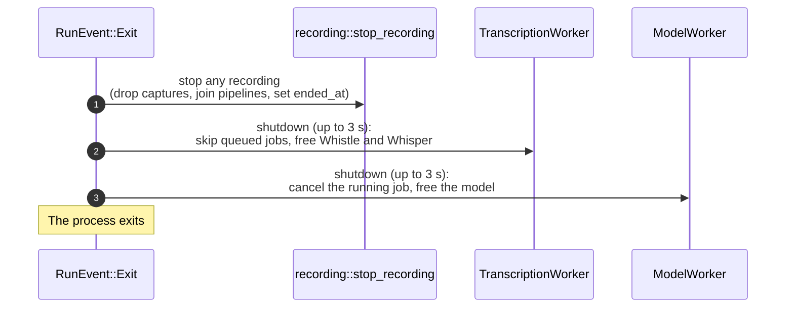
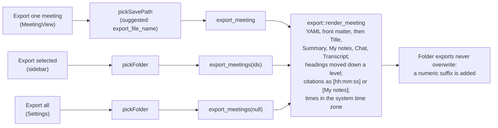
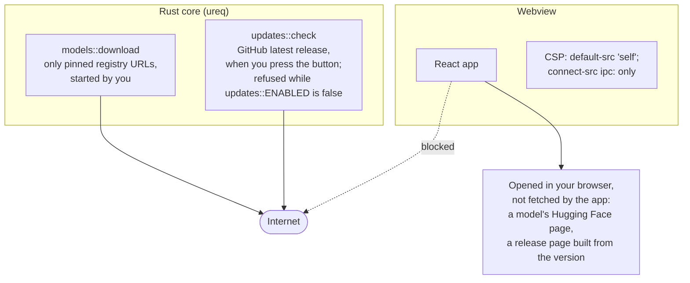
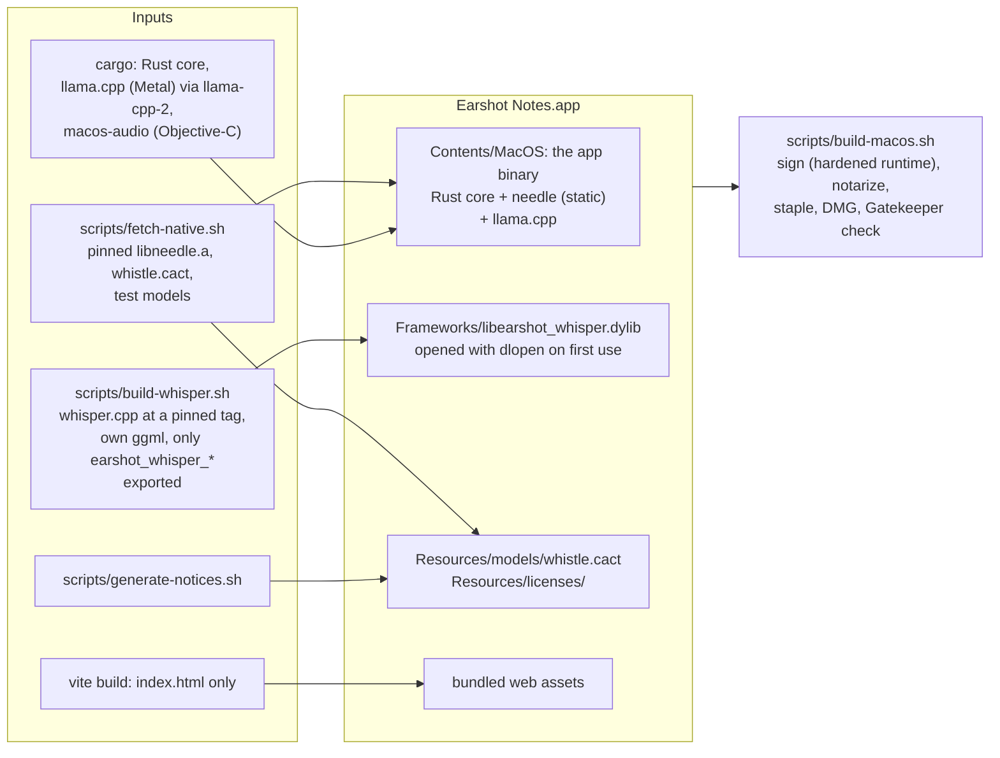

# App shell and lifecycle

[Architecture overview](README.md)

Earshot Notes runs in the menu bar. The window can close while a recording continues, and quitting has to free the native models in a set order. This page covers startup, the menu bar and window, quitting, exporting, the network boundary, and how the app is packaged.

## Startup

## Menu bar and window

- **The page stays loaded while hidden**, so it keeps receiving events and reopens where it was.
- **The Dock icon** is shown and hidden only through `macos_audio::show_dock_icon` and `hide_dock_icon`, on the main thread. Tauri's activation policy redraws the whole menu bar.
- **Recording from the menu bar:** the toggle runs on the blocking pool. Starting creates an untitled meeting and records it, deleting the meeting again if recording can't start. Starting and stopping use the same `commands::recording::start` and `stop` as the window, which emit `recording:changed` and update the menu's status and icon. The window then opens the new meeting.
- **Recording a new meeting from the window:** with **Start recording when I create a new meeting** on (`record_new_meetings` in `settings`), **New meeting** opens the meeting and its `RecordingControls` starts recording once, as if you clicked **Start recording**, so progress and errors look the same. Unlike the menu bar, the window keeps the meeting when recording can't start, and starts nothing while another meeting is recording.

## Quitting

**Quit** in the menu bar or the app menu calls `app.exit(0)`. `RunEvent::Exit` then frees everything native in order, because ggml's Metal backend aborts the process at exit while a model is loaded.

Quitting calls `recording::stop_recording` directly rather than `commands::recording::stop`, since there's no window or menu left to update.

## Exporting

## The network boundary

Logs stay on the Mac, and never include transcript, notes, or summary text.

## Packaging

whisper.cpp and llama.cpp each include ggml, and two copies can't be linked into one binary. That's why whisper.cpp is a separate dynamic library that exports only Earshot's C interface.

## Where the code is

| Concern | Code |
|---|---|
| Startup, commands list, quitting | `src-tauri/src/lib.rs` |
| Menu bar | `src-tauri/src/tray.rs` |
| Window and Dock icon | `src-tauri/src/window.rs`, `src-tauri/crates/macos-audio` |
| Export | `src-tauri/src/export.rs`, `src-tauri/src/commands/export.rs`, `src-tauri/src/store/export.rs` |
| Update check | `src-tauri/src/updates.rs`, `src-tauri/src/commands/updates.rs` |
| Content Security Policy, bundle | `src-tauri/tauri.conf.json` |
| Build and release | `scripts/build-macos.sh`, `docs/building.md` |
