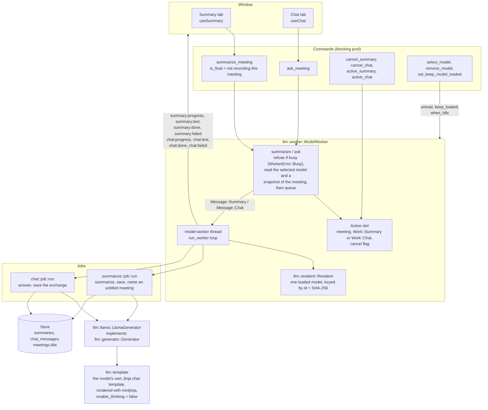
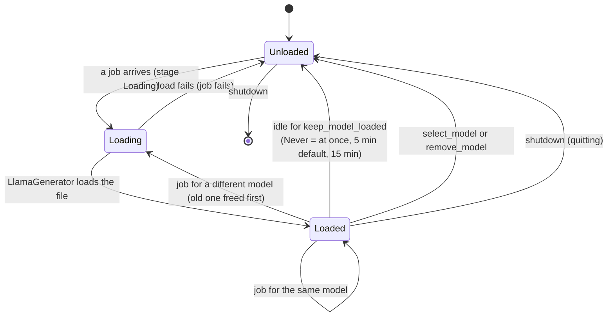
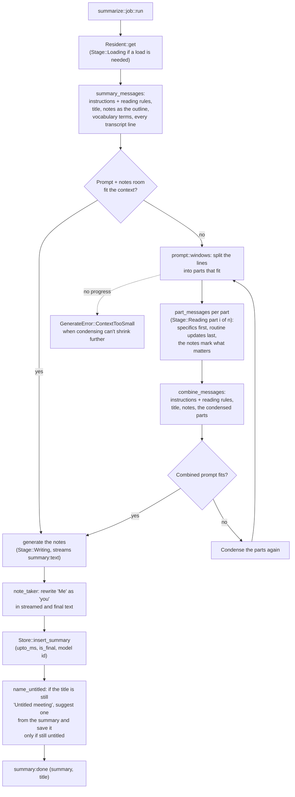
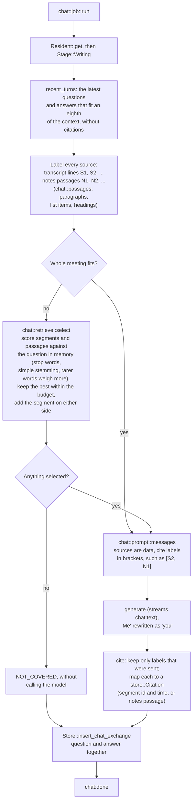

# Local AI model

[Architecture overview](README.md)

The local AI model writes summaries and answers questions about a meeting. One thread, `model-worker`, owns the model and runs one job at a time, either a summary or a chat question. Both run llama.cpp on the GPU through `llama-cpp-2`.

## Components

- **One job at a time.** A summary requested while a question runs, or the reverse, is refused with a message naming what's running.
- **Summarizing when a recording stops (#142).** With **Summarize a meeting when I stop recording** on (`summarize_on_stop` in `settings`), `commands::recording::stop` asks the transcription worker to call `ModelWorker::summarize_stopped` once the segments the stop flushed are transcribed and saved (`TranscriptionWorker::after_queued`). That queues a `SummarizeStopped` message instead of being refused, so it waits behind a running question. When the thread reaches it, a meeting with any summary, partial or not, or with no model selected, is skipped; anything else that stops it, such as nothing to summarize, is reported as `summary:failed`, which the **Summary** tab shows. A request you made while it waited goes first. Quitting skips it: `ModelWorker::shutdown` sets `closing` before the thread reaches it, and quitting stops the recording without `commands::recording::stop`.
- **Snapshots, not live reads.** `summarize` and `ask` read the meeting's notes, segments, vocabulary terms, and chat history on the caller's thread and pass them in the job. A job sees the meeting as it was when you asked.
- **The `Generator` trait** separates the summary and chat logic from llama.cpp, so their tests use fakes.

## Model lifecycle

- **Idle unloading.** The thread waits on its queue with `recv_timeout` set to the idle limit while a model is loaded. A timeout frees the model. **Always** waits without a limit.
- **Removing a model** runs inside `when_idle`, which waits for the active slot to clear, so a running job never loses its model.
- **Quitting** sets the running job's cancel flag and sends `Shutdown`, then waits up to 3 seconds for the model to be freed. ggml's Metal backend aborts the process at exit while a model is loaded.

## Context and memory

`LlamaGenerator` caps the model's context at the smallest of its training length, `llm::llama::MAX_CONTEXT` (32,768 tokens), and its registry `context_limit`, which a model with a fast-growing key-value cache sets lower (a model with no registry entry, such as an import or a model since removed from the list, gets 32K). Each `generate` call creates a fresh llama.cpp context sized to that prompt plus its output room, so short meetings use less memory than long ones.

| Output room | Size |
|---|---|
| Finished notes (`summarize::run::summary_tokens`) | a quarter of the context, at most 4,096 tokens |
| Each condensed part (`part_tokens`) | an eighth of the context, at most 1,024 tokens |
| A chat answer (`chat::answer::answer_tokens`) | a quarter of the context, at most 1,024 tokens |
| Earlier questions and answers sent with a question | an eighth of the context |

## Summaries

The passes that write the notes, `summary_messages` and `combine_messages`, send the instructions in use followed by `prompt::READING_RULES`. The instructions are `prompt::DEFAULT_INSTRUCTIONS` unless you replace them in **Settings** > **Summaries** (`summarize::instructions`, at most 6,000 characters). The reading rules, such as who "Me" is and never inventing facts, always follow, so custom instructions can't change how the meeting data is read. The condense and title prompts never change. Only your own text is stored, so without it summaries follow the default of the running version. A summary copies the instructions when it's queued.

## Chat

- Answers come from the transcript and **My notes**, never from the summary.
- A cancelled or failed question isn't saved. The window puts it back in the question box.
- The window renders each citation as a button: a transcript time scrolls the transcript to the segment (`showSegment`), and **My notes** opens the notes with the passage selected.

## Where the code is

| Concern | Code |
|---|---|
| Worker, queue, busy rules, idle unloading | `src-tauri/src/llm/worker.rs` |
| Keeping one model loaded, `KeepLoaded` | `src-tauri/src/llm/resident.rs` |
| llama.cpp loading, context sizing, sampling, streaming | `src-tauri/src/llm/llama.rs` |
| Chat templates | `src-tauri/src/llm/template.rs` |
| Summary prompts, condensing, titles, "you" for "Me" | `src-tauri/src/summarize/` |
| Chat retrieval, prompt, citations, saving | `src-tauri/src/chat/`, `src-tauri/src/store/chat.rs` |
| Measuring summary quality | `src-tauri/examples/summary_eval.rs`, `scripts/benchmark/run.ts` |
