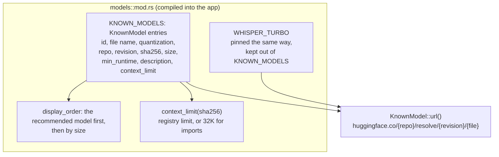
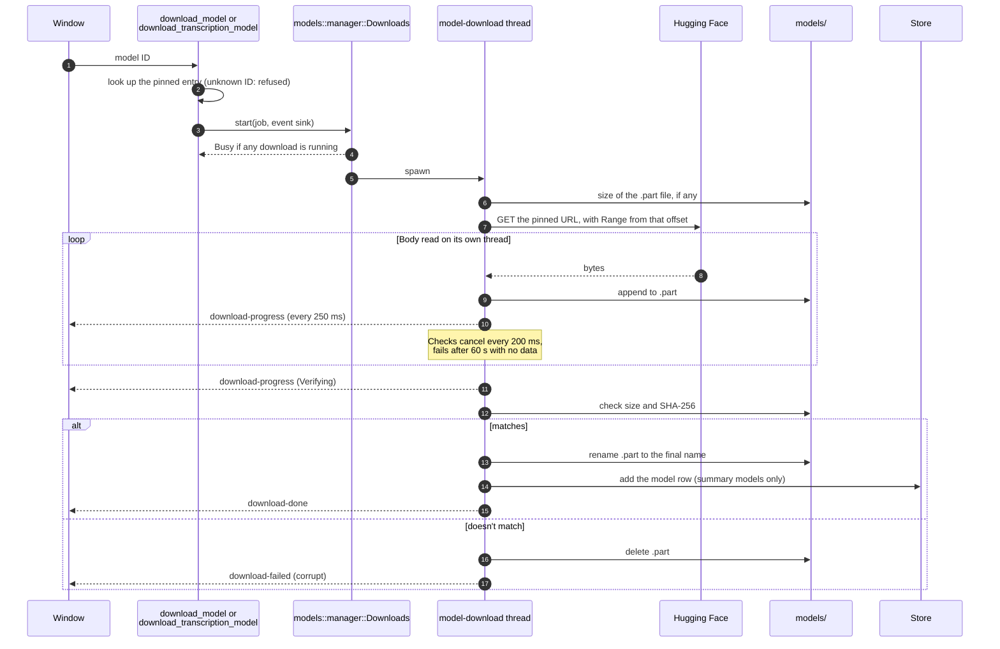
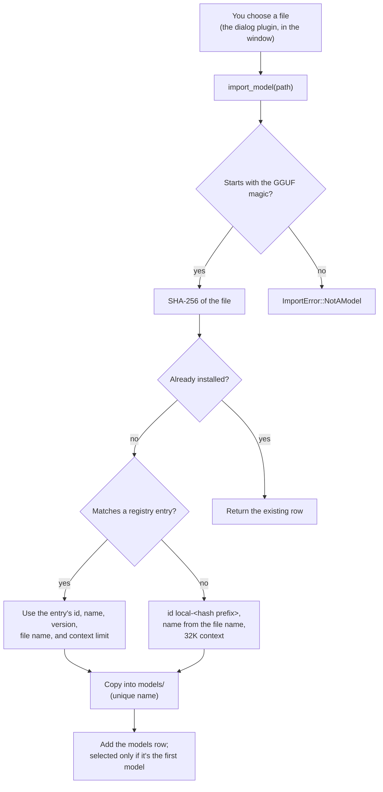
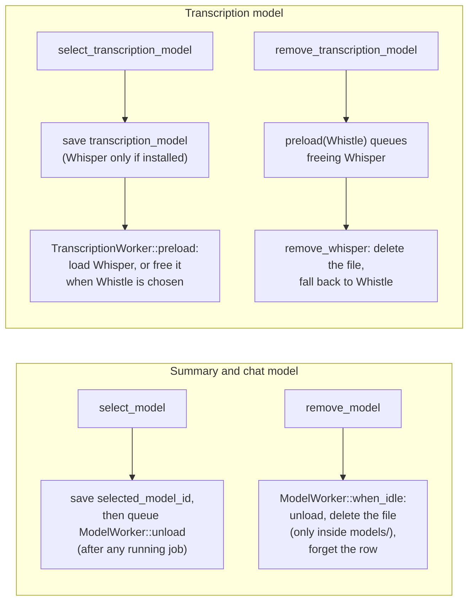

# Models and downloads

[Architecture overview](README.md)

Earshot uses two kinds of model files. Summary and chat models are GGUF files run by llama.cpp. Transcription uses Whistle, bundled with the app, or Whisper large-v3-turbo, an optional download. Every downloadable file is pinned in the app's code to a Hugging Face commit, size, and SHA-256.

## The pinned registry

The UI only ever sends a model ID. The Rust side looks the ID up in the registry and builds the URL, so the window can't make the app download from anywhere else.

## Downloading

- The events are named `model:download-*` for summary models and `transcription:download-*` for Whisper. `Downloads` runs one download at a time across both kinds.
- Cancelling or losing the connection keeps the `.part` file, and the next attempt resumes from it.
- A summary model whose SHA-256 is already installed isn't downloaded again.
- Only a verified file is renamed into place. That's why a Whisper file in `models/` counts as installed with no database row.

## Importing a GGUF file

## Choosing and removing models

The next recording reads `transcription_model` when it starts. A recording already running keeps the engine it started with.

## Where the code is

| Concern | Code |
|---|---|
| Registry, display order, import, removal | `src-tauri/src/models/mod.rs` |
| Download, resume, verify | `src-tauri/src/models/download.rs` |
| One download at a time, events | `src-tauri/src/models/manager.rs`, `src-tauri/src/commands/models.rs` |
| Whistle and Whisper selection | `src-tauri/src/models/transcription.rs`, `src-tauri/src/commands/transcription.rs` |
| Download panel and model lists | `src/features/models/`, `src/features/settings/` |
| Checking for newer pins upstream | `scripts/upstream/check.ts` |
