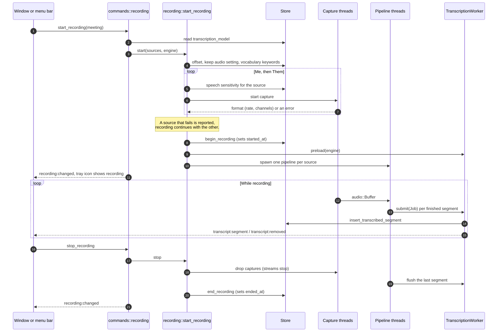
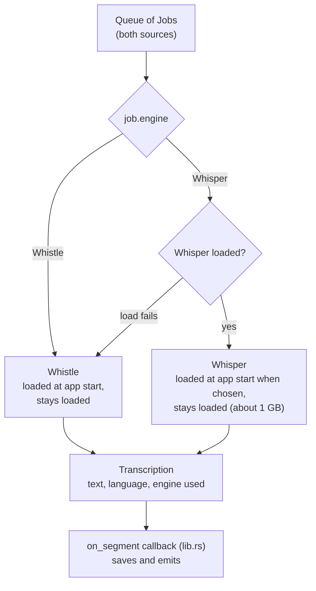
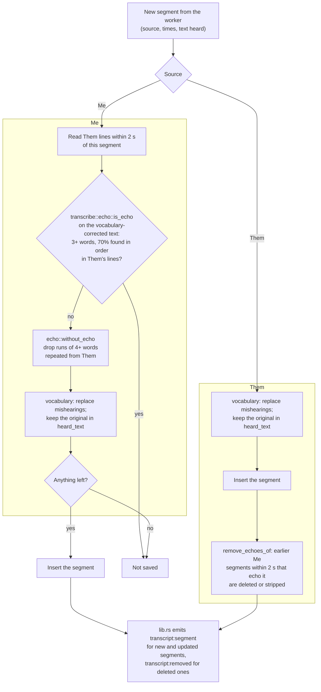

# Recording and transcription

[Architecture overview](README.md)

A recording captures two sources at once: **Me** (the microphone) and **Them** (the Mac's system audio output, which carries the call). Each source gets its own capture thread and pipeline thread. Both feed one transcription worker, which saves segments and pushes them to the window.

## Data flow

```mermaid
flowchart LR
    subgraph me["Source: Me"]
        micdev["Microphone<br/>(chosen device or default)"]
        miccap["audio::mic<br/>cpal input stream"]
        micpipe["audio-pipeline-Me"]
    end
    subgraph them["Source: Them"]
        outdev["Default output device"]
        tap["audio::system<br/>Core Audio process tap<br/>(macos-audio crate)"]
        follower["Follower<br/>rebuilds the tap when the<br/>output device changes,<br/>fills the gap with silence"]
        syspipe["audio-pipeline-Them"]
    end

    micdev --> miccap
    outdev --> tap --> follower
    miccap -- "audio::Buffer<br/>(samples + capture rate)<br/>bounded channel, drops when full" --> micpipe
    follower -- "audio::Buffer" --> syspipe

    subgraph pipeline["recording::run_pipeline (per source)"]
        direction TB
        downmix["downmix to mono"]
        resample["audio::resample::To16k<br/>new resampler when the rate changes"]
        chunker["chunker::Chunker<br/>ends a segment after a 2 s pause<br/>(160 ms once past 20 s), at most 28 s;<br/>measures speech time and loudness"]
        downmix --> resample --> chunker
    end
    micpipe -.-> pipeline
    syspipe -.-> pipeline

    kept["recordings::KeptAudio<br/>WAV writer thread<br/>(Keep audio recordings)"]
    resample -- "16 kHz stream" --> kept

    worker["transcribe::worker::TranscriptionWorker<br/>one thread, one queue"]
    chunker -- "Job: meeting, source,<br/>start/end ms, 16 kHz clip,<br/>speech stats, keywords, engine" --> worker

    subgraph engines["Engines"]
        whistle["transcribe::whistle<br/>Whistle on needle<br/>keyword biasing"]
        whisperEng["transcribe::whisper<br/>Whisper large-v3-turbo<br/>strips [BLANK_AUDIO] labels"]
    end
    worker --> whistle
    worker --> whisperEng

    cleanup["transcribe::cleanup<br/>removes fillers such as 'um',<br/>drops results left empty"]
    whistle --> cleanup
    whisperEng --> cleanup
    phantom["transcribe::phantom<br/>drops 'Thank you.' and similar<br/>from weak clips"]
    cleanup --> phantom

    save["Store::insert_transcribed_segment<br/>vocabulary corrections,<br/>echo removal"]
    phantom --> save
    db[("transcript_segments")]
    save --> db
    ui["Window"]
    save -- "transcript:segment<br/>transcript:removed" --> ui
```

## Starting and stopping a recording

Every start and stop goes through `commands::recording::start` and `stop`, never `recording::start_recording` directly. Those commands update the menu bar and emit `recording:changed`, which is how the window learns about a recording started from the menu bar.

## The transcription worker

- needle holds one process-global, non-thread-safe model, so Whistle lives only on this thread.
- Whistle and Whisper both receive 16 kHz mono clips of at most 28 seconds.
- **Settings** > **Transcription** loads Whisper when chosen and frees it when you choose Whistle or remove the file.

## Saving a segment

`Store::insert_transcribed_segment` (`store/transcribed.rs`) is the only way segments are saved. It runs in one transaction on the store's connection, so the vocabulary and the nearby segments it reads can't change mid-save.

Without headphones, participants' words come back through the microphone as **Me**. Echo removal compares text, not audio, because the two sources close segments on their own pauses and either can arrive first.

## Where the code is

| Concern | Code |
|---|---|
| Start, stop, and the pipeline loop | `src-tauri/src/recording.rs` |
| Microphone capture and device list | `src-tauri/src/audio/mic.rs` |
| System audio tap and output-device following | `src-tauri/src/audio/system.rs`, `src-tauri/crates/macos-audio` |
| Resampling to 16 kHz | `src-tauri/src/audio/resample.rs` |
| Speech segmentation and sensitivity | `src-tauri/src/chunker.rs` |
| Kept audio | `src-tauri/src/recordings.rs` |
| Worker, engines, filler cleanup, phantom filter, echo | `src-tauri/src/transcribe/` |
| Vocabulary terms and corrections | `src-tauri/src/vocabulary.rs`, `src-tauri/src/store/transcribed.rs` |
