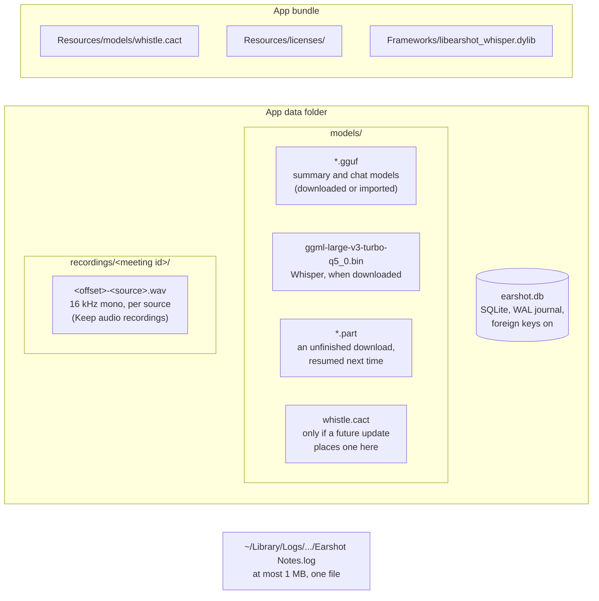
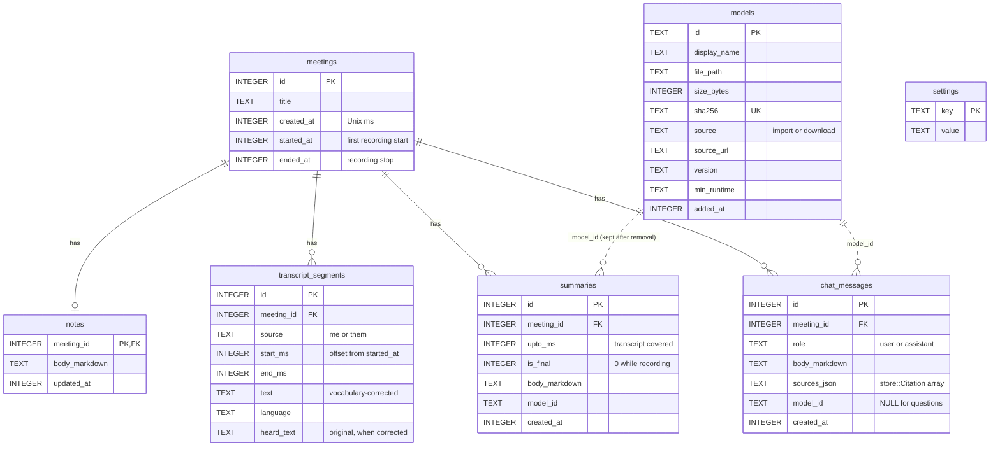
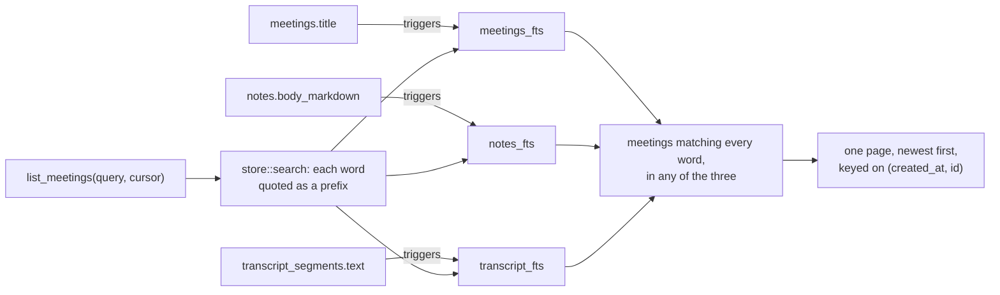

# Storage

[Architecture overview](README.md)

Everything Earshot keeps lives in the app data folder (`~/Library/Application Support/com.tedpresley.earshot/`): one SQLite database, the downloaded and imported models, and kept audio when that setting is on. Logs go to `~/Library/Logs/com.tedpresley.earshot/`.

## Files on disk

## Database schema

Migrations are numbered SQL files in `src-tauri/migrations/`, applied in order by `store::migrations` using `PRAGMA user_version`.

- Every table that belongs to a meeting cascades on delete. Deleting a meeting also deletes its kept audio folder, and it's refused while that meeting is recording.
- `models` has no foreign keys to it. Summaries and answers keep the model's ID after the model is removed.
- Whisper has no row in `models`. It counts as installed when its file is in `models/`.
- At startup, `close_interrupted_recordings` sets `ended_at` on any meeting left recording by a crash or forced quit.

## Settings

Key and value rows in `settings`, read and written through `Store::setting` and `Store::set_setting`.

| Key | Holds | Read when |
|---|---|---|
| `selected_model_id` | the summary and chat model | each summary or question |
| `keep_model_loaded` | `KeepLoaded`: never, 5 or 15 minutes, always | worker start, and when changed |
| `transcription_model` | `whistle` or the Whisper ID | app start, recording start, and when changed |
| `input_device_id` | the chosen microphone | recording start |
| `mic_speech_sensitivity`, `system_speech_sensitivity` | `chunker::Sensitivity` per source | recording start |
| `vocabulary` | terms and mishearings, as JSON | recording start, each saved segment, prompts |
| `keep_audio_recordings` | `on` to keep WAV files | recording start |
| `setup_complete` | whether the setup checklist finished | when the window loads |

Opening at login isn't stored here: it's macOS's own login item setting, read each time.

## Search

- The three FTS5 tables are external-content indexes with the `unicode61 remove_diacritics 2` tokenizer, so search ignores case and accents.
- Triggers keep them in step with inserts, updates, and deletes. A migration that rebuilds one of those tables must recreate its index and triggers.
- Paging uses a cursor on `(created_at, id)` with the `meetings_page` index, not an offset.

## Concurrency

`Store` holds one `rusqlite::Connection` behind a `Mutex`. Every caller, whether a command on the blocking pool, the transcription worker, or the model worker, takes the lock for its query or transaction. Writes that must agree with what they read, such as saving a transcribed segment or reapplying the vocabulary, run in a single transaction under that lock.

## Where the code is

| Concern | Code |
|---|---|
| Connection, migrations | `src-tauri/src/store/mod.rs`, `src-tauri/src/store/migrations.rs` |
| Meetings, notes, paging | `src-tauri/src/store/meetings.rs` |
| Segments, recording start and end | `src-tauri/src/store/transcript.rs`, `src-tauri/src/store/transcribed.rs` |
| Search | `src-tauri/src/store/search.rs` |
| Summaries, chat, models, settings, vocabulary | `src-tauri/src/store/summaries.rs`, `chat.rs`, `models.rs`, `settings.rs`, `vocabulary.rs` |
| Export queries | `src-tauri/src/store/export.rs` |
| Kept audio files | `src-tauri/src/recordings.rs` |
