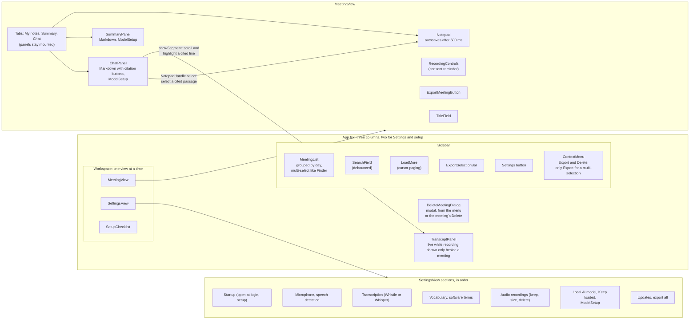
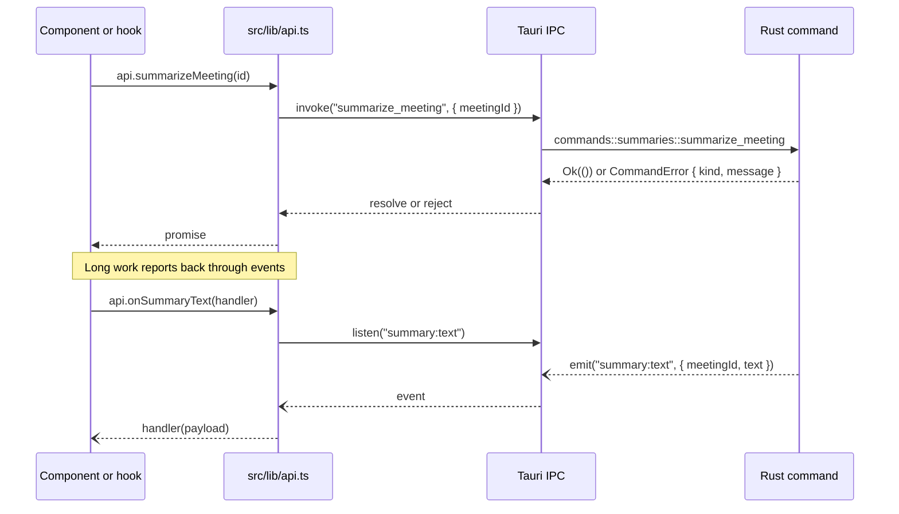
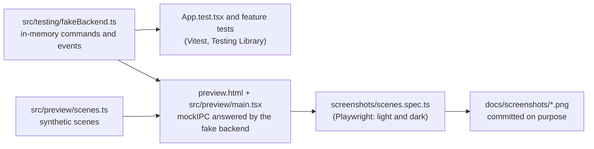

# User interface

[Architecture overview](README.md)

The window is a React 19 app in TypeScript, built by Vite and run in the system webview. It has no router and no state library: `App.tsx` holds the shared state, and each feature under `src/features/` keeps its components, hooks, and tests together. Every call to the Rust core goes through `src/lib/api.ts`.

## Layout and components

- **State lives in hooks.** `useMeetingList` pages and searches the list, `useSummary` and `useChat` follow their jobs through events, and `useAutosave` saves notes in order without losing the last edit.
- **Model output is Markdown, never HTML.** `features/summary/Markdown.tsx` renders summaries and answers; its `citation` prop turns `[S3]` and `[N1]` groups into buttons.
- **`ModelSetup`** (the download panel) renders only in the visible tab, so the Summary and Chat tabs never both listen to download events.

## Talking to the core

`api.ts` declares about 60 commands and these events:

| Events | Sent by | Used by |
|---|---|---|
| `transcript:segment`, `transcript:removed` | the transcription callback in `lib.rs` | `TranscriptPanel` |
| `recording:changed` | `commands::recording` | `App` |
| `recording:issue` | `commands::recording`, from the capture threads | `RecordingControls` |
| `summary:progress`, `summary:text`, `summary:done`, `summary:failed` | the model worker | `useSummary`; on `summary:done`, `App` and `MeetingView` also pick up a new title |
| `chat:progress`, `chat:text`, `chat:done`, `chat:failed` | the model worker | `useChat` |
| `model:download-progress`, `model:download-done`, `model:download-failed` | `models::manager` | `ModelSetup` (Summary tab, Chat tab, Settings) |
| `transcription:download-progress`, `transcription:download-done`, `transcription:download-failed` | `models::manager` | `TranscriptionSection` |

File pickers (`pickModelFile`, `pickSavePath`, `pickFolder`) use the Tauri dialog plugin from `api.ts`. The chosen path then goes to a command, such as `import_model` or `export_meeting`.

## Tests, previews, and screenshots

The real `App` renders in all three. Only `index.html` is bundled into the app, so the fake backend and preview never ship.

## Where the code is

| Concern | Code |
|---|---|
| Shell, shared state, view switching | `src/App.tsx` |
| Commands, events, types | `src/lib/api.ts` |
| Meeting list, search, selection, meeting view | `src/features/meetings/` |
| Notes, transcript, summary, chat | `src/features/notepad/`, `transcript/`, `summary/`, `chat/` |
| Recording controls and consent | `src/features/recording/` |
| Settings, setup, model download panel, export | `src/features/settings/`, `setup/`, `models/`, `export/` |
| Styling | `src/styles.css` (custom properties, light and dark) |
